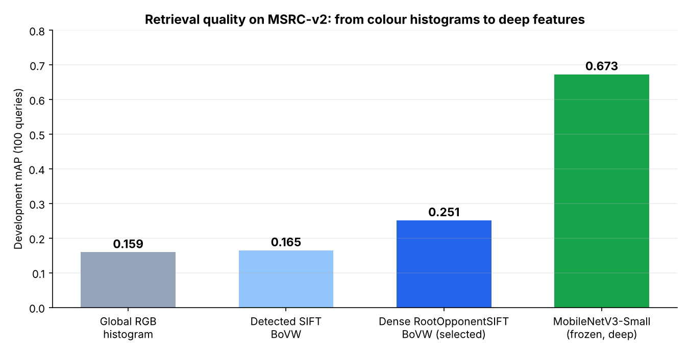
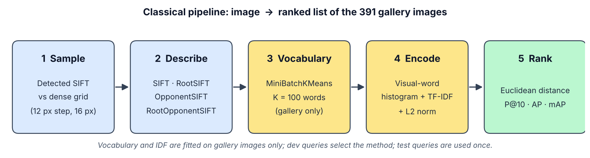
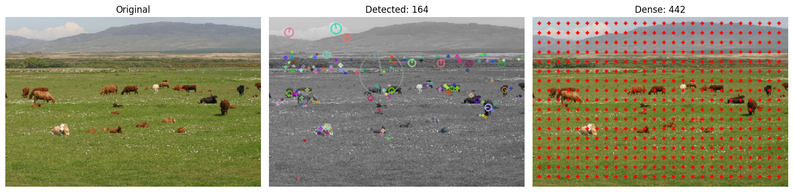
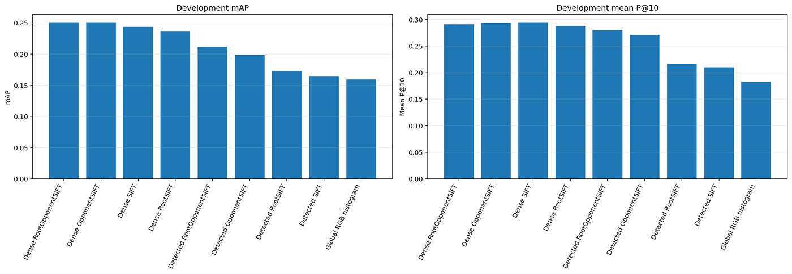
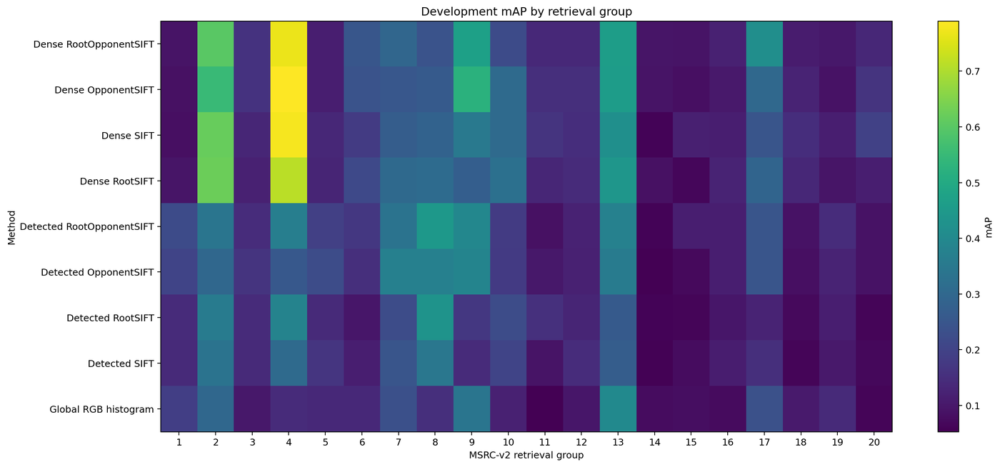
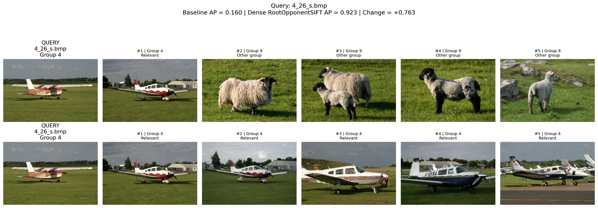
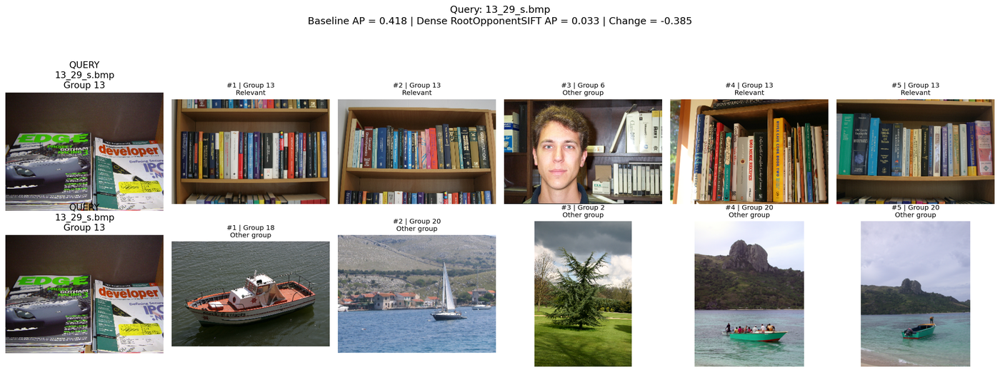
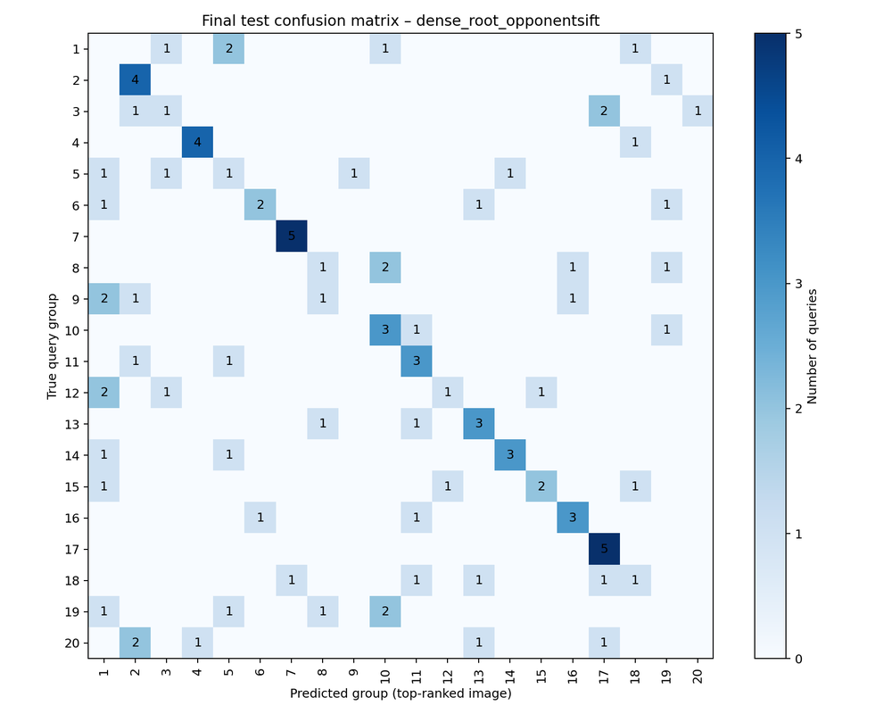
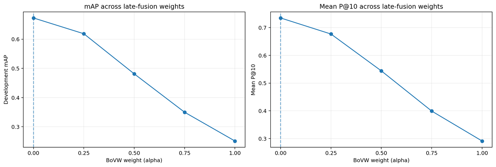
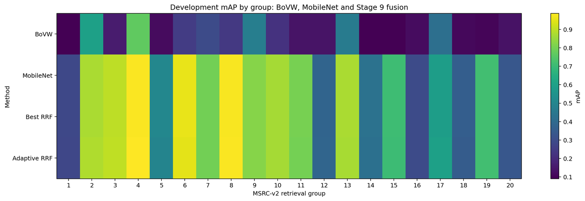

# Visual Search with Bag-of-Visual-Words and Deep Features

**A controlled study of how local-feature sampling and descriptor choice affect image retrieval on MSRC-v2, built with OpenCV, scikit-learn and PyTorch.**

Given a query photo, the system ranks 391 gallery images from most to least similar. I started from a colour-histogram baseline, built a classical SIFT + Bag-of-Visual-Words (BoVW) retrieval engine, picked the best configuration on development queries, evaluated it once on held-out test queries, and then tested whether a frozen deep network and score fusion could do better.



## Results at a glance

| Method | Dev mAP | Dev P@10 |
|---|---:|---:|
| Global RGB histogram (baseline) | 0.159 | 0.183 |
| Detected SIFT BoVW | 0.165 | 0.210 |
| **Dense RootOpponentSIFT BoVW (selected classical method)** | **0.251** | **0.291** |
| MobileNetV3-Small, frozen (extension) | 0.673 | 0.735 |

- **Dense sampling beat detected keypoints** in every comparison, and colour-opponent descriptors added a further gain. The selected method improved on the baseline by +0.092 mAP, with a paired-bootstrap 95% CI of [0.067, 0.118] (3,000 resamples).
- **Held-out test (run once, no tuning):** mAP 0.247, P@10 0.300, versus 0.251 / 0.291 on development, so the dev result held up on unseen queries.
- **A pretrained MobileNetV3-Small beat BoVW by a wide margin** on development queries. None of the fusion schemes I tried (fixed-weight, min-max, Z-score, reciprocal-rank fusion, confidence-adaptive) beat the deep network alone.

> Note: the deep-feature and fusion experiments were scored on development queries only. The test set was reserved for the frozen classical method.

## How the project flows



| Step | What I did | Notebook (in `notebooks/`) |
|---|---|---|
| 1. Baseline | 64-bin RGB histogram with Euclidean distance. | `01` |
| 2. Sampling | Compared detected SIFT with dense SIFT (12 px grid, 16 px keypoints). | `01`, `02` |
| 3. Descriptors | Added RootSIFT and OpponentSIFT (384-D, three colour-opponent channels). Eight configurations in total. | `03` |
| 4. Vocabulary | MiniBatchKMeans, K = 100, up to 200 descriptors per gallery image, fixed seed. **Gallery images only.** | `04` |
| 5. Encoding | Visual-word histograms, then TF-IDF (IDF fitted on gallery only), then L2 normalisation. | `05` |
| 6. Development evaluation | P@10, AP, mAP, per-group heatmap, paired bootstrap against the baseline. | `06` |
| 7. Deep descriptors | Frozen MobileNetV3-Small, 576-D features. | `07` |
| 8. Late fusion | Fixed-weight blend of BoVW and deep similarity. | `08` |
| 9. Adaptive fusion | Min-max, Z-score, weighted RRF and confidence-guided query-adaptive RRF. | `09` |
| 10. Final test | Frozen method, 100 held-out queries, confusion matrix. | `10` |

**Evaluation protocol.** A fixed split of 391 gallery, 100 development and 100 test images (5 queries per group in each query set). Vocabulary and IDF were fitted on gallery images only, settings were chosen on development queries only, and the test set was used once.

## What the experiments showed

### 1. Dense sampling gives more useful local features than detected keypoints

Detected SIFT places keypoints only where the algorithm finds distinctive structure (as few as 3 per image in this dataset). Dense sampling gives every image a regular grid of descriptors (442 or more), which suits scene- and object-category retrieval better.



### 2. Colour-opponent descriptors help, RootSIFT is less consistent



Opponent-colour descriptors improved most configurations. RootSIFT helped the detected variants but not every dense one. Dense OpponentSIFT and Dense RootOpponentSIFT tied on mAP to four decimals (0.2511), and the latter was chosen using the unrounded value, so I treat the two as equivalent.

### 3. Gains are uneven across object categories



Groups with distinctive local patterns, such as aircraft (group 4, test mAP 0.84) and group 2 (test mAP 0.60), do well. Many other groups stay near 0.1 to 0.2.

### 4. Where it works and where it fails

**Success: aircraft query (AP 0.16 to 0.92).** The baseline is pulled towards sheep because of the shared green grass; BoVW returns five aircraft.



**Failure: bookshelf query (AP 0.42 to 0.03).** The RGB histogram happens to match the book images by colour, while BoVW returns boats and landscapes. Textures and edges are shared across unrelated scenes, and a BoVW histogram discards where those features were in the image.



These examples were chosen because they show large changes, so they are not typical queries.

### 5. Final held-out test

Top-1 group accuracy is 42 of 100. This is a different measure from mAP: a query can miss at rank 1 but still pull relevant images further down the ranking.



### 6. Deep features and fusion

Blending BoVW into the deep similarity scores made development results worse as the BoVW weight increased (0.673 at 0%, 0.619 at 25%, 0.481 at 50%, 0.350 at 75% BoVW).



An oracle that picks the best weight per query using the true AP reaches only 0.684 mAP. That is a diagnostic upper bound, not a usable method, and it suggests the two representations complement each other on very few queries.



## Limitations

- MSRC-v2 is small (591 images). Group-level differences rest on 5 queries per group and should be read as indicative.
- Only K = 100 visual words was explored in the reported experiments, and the vocabulary was trained on a sample of at most 200 descriptors per image.
- BoVW histograms carry no spatial information. Spatial pyramids or geometric verification are natural next steps.
- The deep model is frozen and ImageNet-pretrained, with no fine-tuning, and was evaluated on development queries only.

## Repository layout

```
.
├── notebooks/              Numbered pipeline, run in order (01 → 10)
├── visual_search/          SIFT extraction, caching, vocabulary training, BoVW/TF-IDF encoding
├── cvpr/                   Dataset loading, evaluation (P@10, AP, mAP) and plotting utilities (module-supplied)
├── scripts/                Command-line baseline check and deep-descriptor precompute
├── results/                CSVs, figures and ranked-retrieval examples for every stage
├── bovw_vocabularies/      Trained visual vocabularies (K = 100)
├── bovw_features/          Encoded BoVW histograms and IDF weights
├── deep_features/          Cached MobileNetV3-Small descriptors
├── docs/                   README images and detailed setup guide
├── split_manifest.csv      Fixed gallery / dev / test split
├── requirements.txt        Core dependencies
└── requirements-deep.txt   Extra dependencies for the deep-feature stages
```

## Reproduce it

The MSRC-v2 images are **not included**. Obtain the dataset from Microsoft Research Cambridge, then:

```bash
pip install -r requirements.txt
pip install "scikit-learn>=1.2"
pip install -r requirements-deep.txt     # only for the deep-feature stages (7-9)
```

In each notebook, set `PROJECT_ROOT` (this folder) and `DATASET_SOURCE` (extracted dataset folder, its `Images` folder, or the original ZIP), then run the notebooks in `notebooks/` from `01` to `10` in order. Large SIFT caches are git-ignored and are regenerated automatically. Full instructions, including Google Colab, are in [`docs/SETUP.md`](docs/SETUP.md).

Quick check of the baseline:

```bash
python scripts/run_baseline.py /path/to/MSRC_ObjCategImageDatabase_v2.zip --split dev
```

## Tech stack

Python, NumPy, OpenCV (SIFT), scikit-learn (MiniBatchKMeans), PyTorch / torchvision (MobileNetV3-Small), Matplotlib, Jupyter, Google Colab.

## Credits and references

Built on the starter framework supplied for the University of Surrey module EEE3032 *Computer Vision and Pattern Recognition* (dataset loading, fixed split, baseline and evaluation utilities in `cvpr/`). Image examples are drawn from the MSRC-v2 dataset (Microsoft Research Cambridge) and are shown for illustration only.

1. D. G. Lowe, "Distinctive image features from scale-invariant keypoints," *IJCV*, 2004.
2. R. Arandjelović and A. Zisserman, "Three things everyone should know to improve object retrieval," *CVPR*, 2012.
3. K. van de Sande, T. Gevers and C. Snoek, "Evaluating color descriptors for object and scene recognition," *IEEE TPAMI*, 2010.
4. J. Sivic and A. Zisserman, "Video Google: A text retrieval approach to object matching in videos," *ICCV*, 2003.
5. D. Sculley, "Web-scale k-means clustering," *WWW*, 2010.
6. A. Howard et al., "Searching for MobileNetV3," *ICCV*, 2019.
7. G. V. Cormack, C. L. A. Clarke and S. Büttcher, "Reciprocal rank fusion outperforms Condorcet and individual rank learning methods," *SIGIR*, 2009.

**Author:** Amna Ahmad
